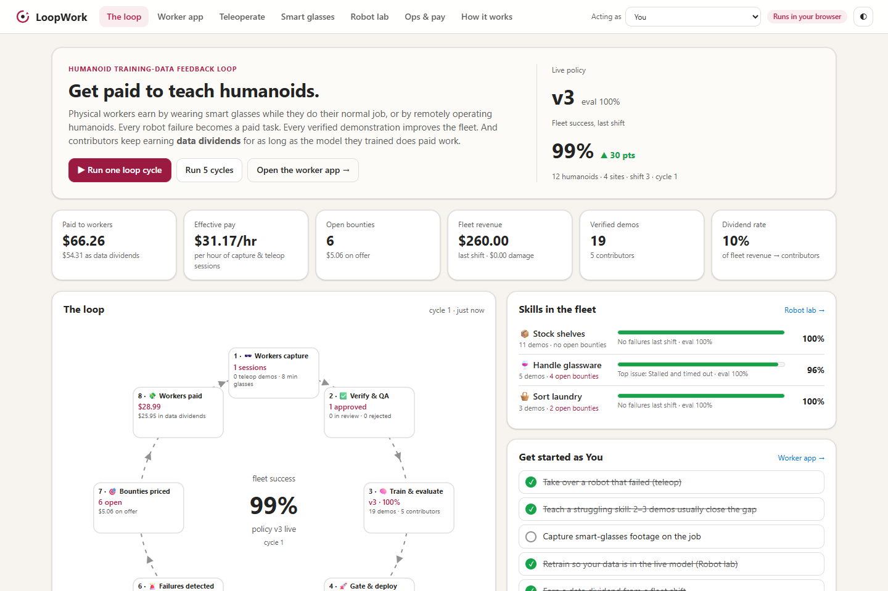
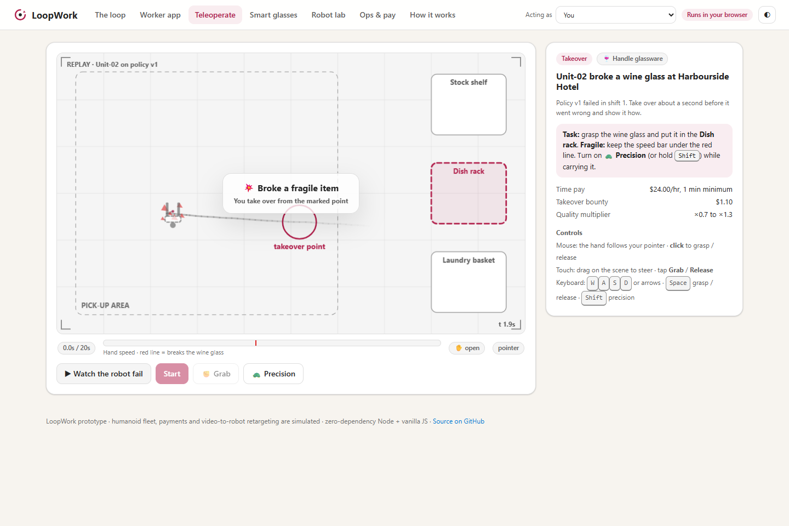
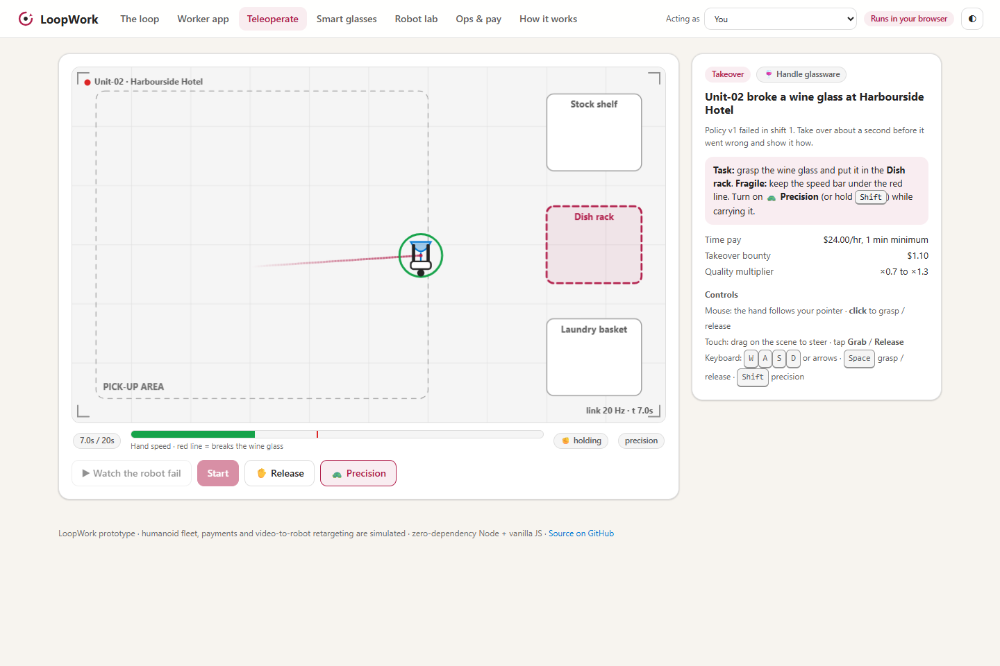
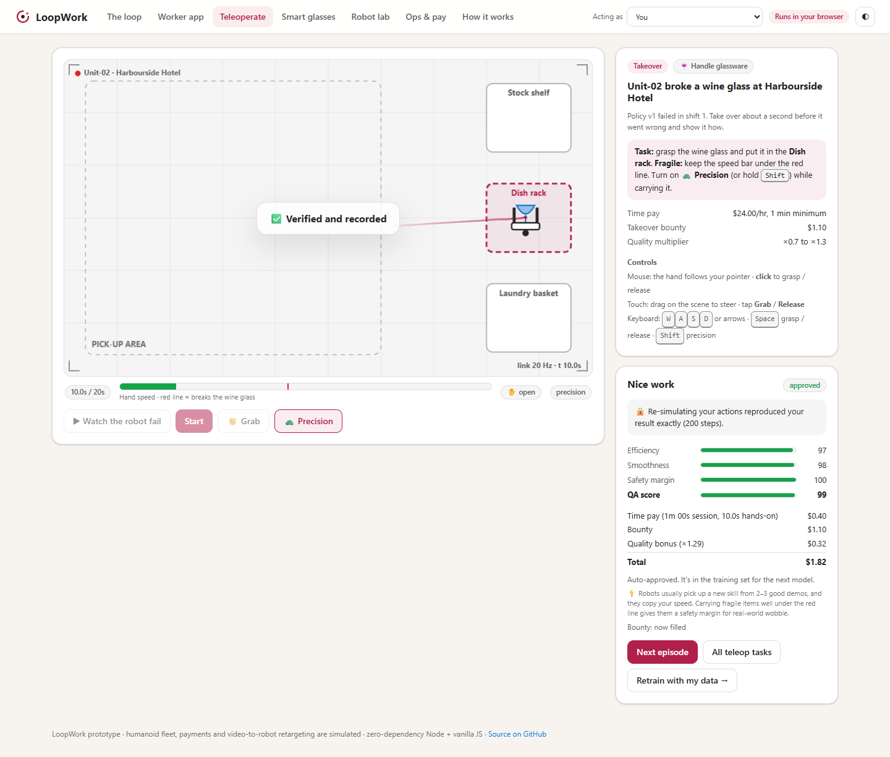
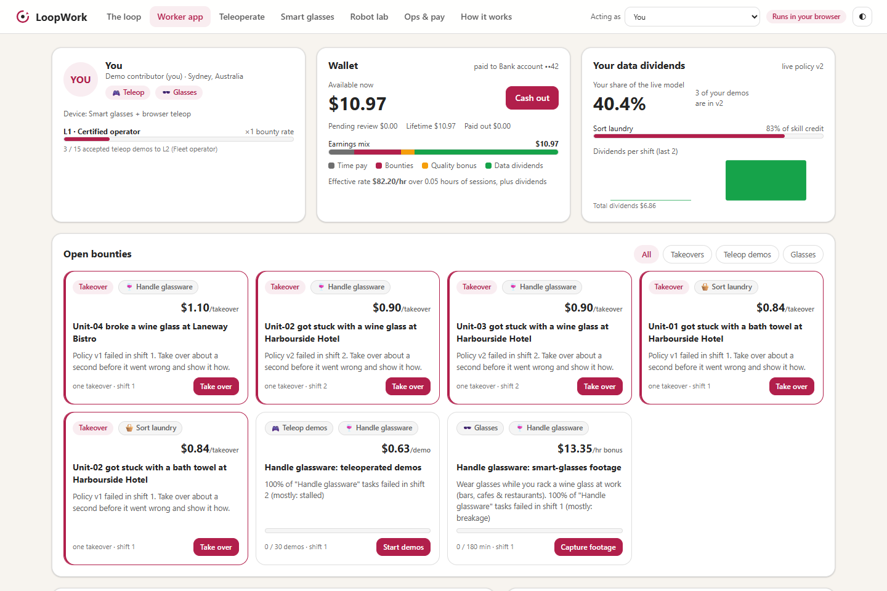
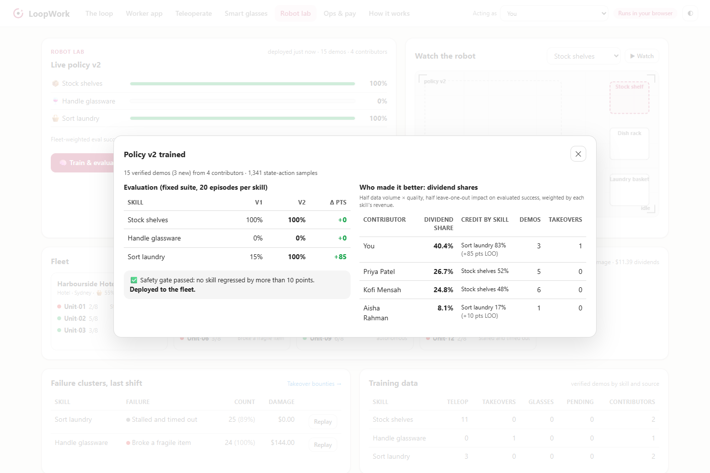
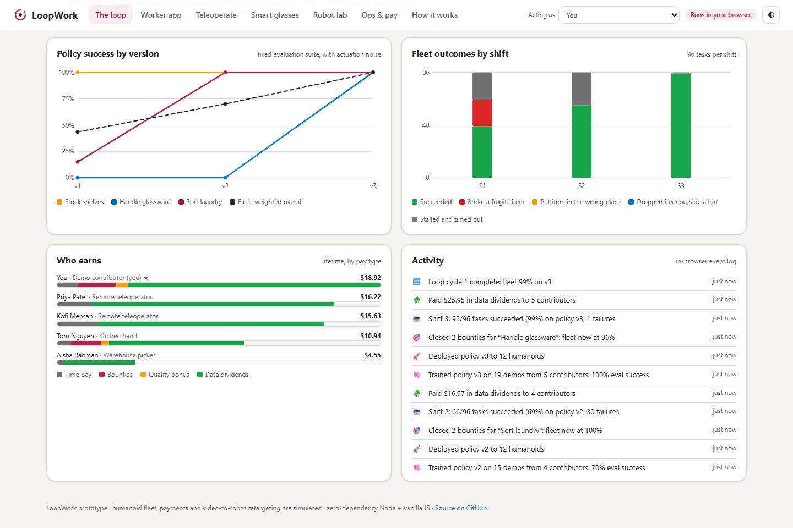
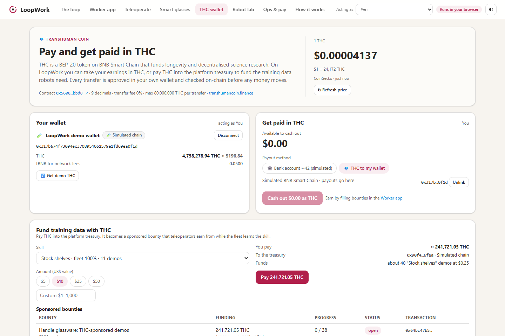
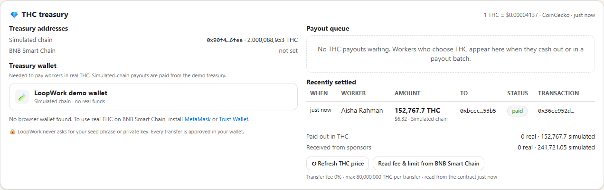
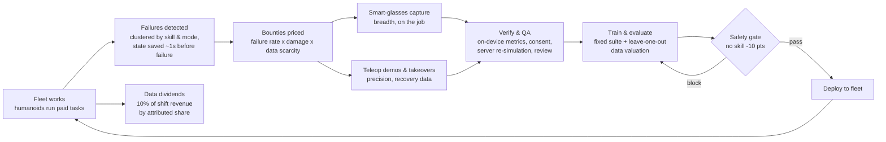

# LoopWork: get paid to teach humanoids

**▶ Try it in your browser: https://peterxing.github.io/loopwork/** (desktop or phone; nothing to install, and your progress stays in your browser).

LoopWork is a working prototype of a **humanoid training-data feedback loop**. Physical workers get paid to **wear smart glasses while they do their normal job** or to **remotely operate humanoid robots**. Every robot failure becomes a priced task, every verified demonstration improves the fleet, and contributors keep earning **data dividends** for as long as the model they helped train does paid work.



It runs end to end with **zero dependencies** (Node 20+, no `npm install`): a real marketplace, server-side replay verification, QA, dynamic pricing, training, evaluation, data valuation, a safety-gated deploy, a fleet of 12 simulated humanoids, and an itemised pay ledger.

## Quick start

```powershell
git clone https://github.com/peterxing/loopwork.git
cd loopwork
node server.js            # http://127.0.0.1:8787
node server.js --reset    # start again from the pilot
npm test                  # 54 tests: sim, policy, engine, HTTP API, static build, THC payments
```

No server? Open `public/index.html` directly in a browser. The same engine runs in the page ("Offline demo" badge), with state kept in `localStorage`.

## A five-minute tour

1. **Robot lab → Watch the robot.** Policy v1 was piloted on parcel boxes only. It shelves boxes fine, smashes wine glasses and puts towels in the wrong bin. The fleet runs at ~49%.
2. **Worker app → a takeover bounty** ("Unit-02 broke a wine glass at Harbourside Hotel"). Click **Watch the robot fail**, then take over about a second before the mistake. Steer with your mouse and click to grasp and release (on a phone: drag on the scene and tap **Grab**). Switch on **🐢 Precision** (or hold **Shift**) while carrying fragile items. Your actions are re-simulated to verify them, then you're paid time + bounty + quality bonus.
3. Do **two "Sort laundry" demos**, then **Robot lab → Train & evaluate**. Laundry jumps from ~15% to ~100%. The attribution table shows you holding a large share of the new model's credit.
4. **Run fleet shift.** 10% of the shift's revenue is paid out as data dividends. Check your wallet in the **Worker app**.
5. **Smart glasses:** simulate a shift (or upload a real clip, which is analysed on-device). Try the "dim kitchen" preset to see footage routed to human review in **Ops & pay**.
6. **THC wallet:** connect the built-in demo wallet, tap **Get demo THC**, and fund a bounty with Transhuman Coin. Then act as Aisha Rahman and cash out in THC. The treasury's payment is checked against its receipt before the money counts as paid.
7. **The loop → Run 5 cycles.** Simulated contributors fill bounties, models retrain and deploy, and the fleet climbs to ~99%. Then **Onboard Coastal Kitchen Co.** to add a brand-new skill gap (dinner plates) and watch the loop restart.

| Watch the robot fail… | …then take over |
|---|---|
|  |  |
| **Verified result and pay** | **Worker app** |
|  |  |
| **Training, gate and attribution** | **Charts** |
|  |  |
| **THC wallet: get paid or fund training data** | **THC treasury: payouts verified on-chain** |
|  |  |

## How the loop works



## Economics

| Pay component | How it works (defaults, all adjustable in **Ops & pay**) |
|---|---|
| **Time pay** | Teleop: $24/hr of session time, minimum 1 minute per session, **paid even if the attempt fails**. Glasses: $6/hr of verified footage. |
| **Bounties** | Teleop demo: `8¢ × (1 + 3·severity) × scarcity`, capped at 80¢. Takeover: `30¢ + 60¢·severity` (+20¢ for breakages). Glasses: `+$3/hr × (1 + 2·severity) × scarcity`, capped at $18/hr. `severity` = failure rate (×1.25 for fragile items); `scarcity` falls as verified data accumulates. |
| **Quality multiplier** | `0.7 + 0.6 × QA`, so ×0.7 to ×1.3 on the bounty. Teleop QA combines success, path efficiency, smoothness and safety margin. Glasses QA combines resolution, exposure, sharpness, stability and coverage, gated so dark or blurry footage can't pass. |
| **Levels** | L1 → L2 (15 accepted demos, ×1.1) → L3 (40, ×1.25) on teleop bounties. |
| **Data dividends** | Each shift, 10% of fleet revenue is split by the live model's **attribution**. Per skill, a contributor's credit is 50% data volume × quality and 50% leave-one-out impact on evaluated success, weighted by the revenue each skill earns. |

Bounties open, reprice and close automatically after every shift. Gaps that close stop attracting spend, and every residual failure becomes a takeover bounty, because recovery data from the robot's own failure states is the most valuable data in the loop.

## Pay and get paid in Transhuman Coin (THC)

[Transhuman Coin](https://transhumancoin.finance/) (THC) is a BEP-20 token on BNB Smart Chain ([`0x5608…bbd8`](https://bscscan.com/token/0x56083560594e314b5cdd1680ec6a493bb851bbd8), 9 decimals) that funds longevity and decentralised-science research. LoopWork supports it in both directions, on the **THC wallet** tab and in **Ops & pay → THC treasury**:

- **Receive.** A worker links a wallet and chooses THC as their payout method. Cashing out (from $1) converts their balance at the live THC price (CoinGecko, with DexScreener as a fallback), reserves the money and queues the payout. The platform treasury sends the THC from its own wallet. While that wallet is signing, the payout is locked to that one window, so it can't be paid twice from another window or cancelled mid-flight. It only counts as paid once the transfer's receipt shows the THC arrived; if the transaction reverts, the money goes back to the worker's balance.
- **Pay.** Anyone can pay THC into the treasury to fund training data for a skill. The verified amount becomes a THC-sponsored bounty that the fleet loop never auto-closes or reprices, so the sponsor's money always reaches the workers who fill it.
- **Real wallets.** Wallets are discovered with EIP-6963 (MetaMask, Trust Wallet, Coinbase Wallet, Rabby, OKX and others), with `window.ethereum` as a fallback, and switched to BNB Smart Chain. On a phone without a wallet, LoopWork offers to open itself inside MetaMask or Trust Wallet. Every transfer is approved in the user's own wallet, after an extra "this moves real tokens" confirmation in LoopWork. LoopWork never sees a private key or seed phrase.
- **Demo wallet.** A built-in wallet on a simulated BNB Smart Chain ([`public/lib/chain.js`](public/lib/chain.js)) lets anyone try the whole flow with no real funds, including a faucet for demo THC. It mirrors THC's fee settings and 80M-per-transfer limit, and its receipts have the same shape as real BSC receipts, so one verification path checks both.
- **Verification.** [`public/lib/thc.js`](public/lib/thc.js) decodes the THC contract's Transfer events. Only THC sent by the expected party (the treasury for payouts, the payer for payments), to the right address and after the request was made, counts. Only what actually arrived is credited: if a payout arrives short (say THC's owner switches its SafeMoon-style fees back on; both read 0% on-chain in October 2026), the difference goes back to the worker. Each transaction can settle only one payout or payment, and only once it has been recorded against it. The server always fetches receipts itself, from its simulated chain or public BSC RPCs, and never accepts one from the browser. The parser is tested against a real BSC receipt in [`test/fixtures`](test/fixtures).
- **When things go wrong.** Wallets get closed, switched and sped up, so every in-between state has a way out:
  - If the wallet switches accounts before it sends, nothing is sent.
  - A slow transaction can be checked again later. "Check again" looks at every transaction sent for the payout or payment, and settles it with whichever one arrived.
  - A transaction the wallet sped up or replaced can be attached by its hash.
  - "Send again" and "Mark as dropped" are only allowed once none of the payout's transactions reached the worker or could still be mined. "Mark as dropped" gives the money back to the worker; if a transaction turns up after all, "Check again" still records it.
  - A failed payout comes back to life if a replacement transfer goes through. Recording a replacement takes the money back out of the worker's balance, even if they've already cashed it out again, because the THC has already left the treasury.
  - An earlier transfer can still go through after its payout failed, and a payout can arrive twice. Every transfer that reaches the worker goes on the books exactly once.
  - Either case can leave a worker overdrawn. Then their unsent THC payouts are held until new earnings cover it, and "Send again" is refused if it could pay them twice.
  - If a window closes while its wallet is signing, the lock times out after 10 minutes. Then the payout or payment can be released (only if nothing was sent) or have its transaction attached.
  - Unfinished payment requests expire after a day. Each wallet can have at most five in progress.
- **On the public demo**, each visitor's platform lives in their own browser and the BNB Smart Chain treasury starts unset, so real THC only ever moves between wallets the visitor controls.

## Trust, safety and worker protections

- **Server-side replay verification:** teleop clients send raw actions only. The server re-simulates them bit-for-bit, and outcome, QA and pay are computed there. Mismatched claims and faster-than-real-time submissions are flagged for review. Episodes are single-use and bound to the contributor they were issued to.
- **Consent first:** glasses submissions require workplace permission, bystander notice and privacy-zone confirmation. Faces and screens are always blurred; audio is off by default. In this prototype the **video never leaves the browser**: only QA metrics and pixelated previews are uploaded.
- **Data rights:** opt out of future training at any time. Models already trained keep paying your dividends. An optional "open research" sharing flag is also provided.
- **Safety-gated deploys:** a candidate that regresses any skill by more than 10 points (or overall by more than 2) is blocked. Operators can override or roll back explicitly in the policy registry.
- **Transparent ledger:** every cent is an itemised entry (time, bounty, quality, dividend, payout) with pending, available, void and paid states.

## Architecture

```
loopwork/
├─ server.js              Zero-dependency HTTP server: static files + JSON API, atomic JSON persistence
├─ public/
│  ├─ index.html          App shell + design system (Clawpilot theme variables, light/dark, phone layout)
│  ├─ lib/                Shared by browser AND server (one source of truth)
│  │  ├─ sim.js           Deterministic 2D humanoid-hand manipulation world (20 Hz)
│  │  ├─ policy.js        Structured kNN behaviour cloning + evaluation + actuation noise
│  │  ├─ thc.js           Transhuman Coin: token constants, exact BigInt maths, calldata, receipt verification
│  │  ├─ chain.js         Simulated BNB Smart Chain with THC, for the demo wallet
│  │  └─ engine.js        Marketplace, pricing, QA, pay, THC payments, training, attribution, fleet, API routes
│  └─ app/                Vanilla-JS UI: loop, worker app, teleop console, glasses capture, THC wallet, lab, ops
├─ scripts/build-static.js  Builds the GitHub Pages site (in-browser mode + link-preview tags)
├─ .github/workflows/     Tests on every push and PR; deploys GitHub Pages from main
├─ test/                  node:test suites (sim, policy, engine, server, static build, THC payments)
└─ docs/                  Screenshots
```

State is stored at `~/.loopwork/state.json` (kept out of the project folder, so file sync never fights the server). Override it with `LOOPWORK_DATA`. The server binds to `127.0.0.1` by default (`HOST` and `PORT` can change this) and has **no authentication**: it's a local prototype.

## Hosting

**Public demo (GitHub Pages).** Every push to `main` runs the tests, then `scripts/build-static.js` copies `public/` and switches it to in-browser mode. The [workflow](.github/workflows/pages.yml) publishes the result to https://peterxing.github.io/loopwork/. Each visitor runs their own private copy of the whole platform, including the parts that would normally live on a server, with progress saved in their browser's `localStorage`. Nobody can see or change anyone else's data. Only the THC wallet contacts outside services: it reads THC prices (CoinGecko, DexScreener) and BNB Smart Chain data from public RPCs, and sends the transfers you approve in your own wallet. Build it locally with `npm run build:static` (output in `_site/`).

**Sharing a live server.** `server.js` keeps one shared state for everyone, and anyone who can reach it can act as any contributor, run payouts or reset the demo. To share it with others, put it behind authentication first (for example, a reverse proxy with sign-in). Then bind it to all interfaces: `HOST=0.0.0.0 PORT=8787 node server.js` (in PowerShell, `$env:HOST='0.0.0.0'; node server.js`). API calls use page-relative URLs, so the app also works behind a proxy sub-path.

### API

Routes are defined once in `engine.js` and used by both the client and the server.

| Method | Path | Purpose |
|---|---|---|
| GET | `/api/overview` | KPIs, loop stages, version history, shifts, earnings, activity |
| GET | `/api/workers`, `/api/workers/:workerId` | Contributors; wallet, level, sessions, dividends |
| PATCH | `/api/workers/:workerId/consent` | Audio, open-research and training opt-out flags |
| GET | `/api/bounties?workerId=` | Open bounties (eligibility and level-adjusted rates) |
| POST | `/api/episodes` | Issue a teleop episode (takeovers start from the saved failure state) |
| POST | `/api/episodes/:episodeId/submit` | Submit raw actions → server replay, QA, pay |
| GET | `/api/episodes/:episodeId/robot-attempt` | Bit-exact replay of the robot's failed attempt |
| POST | `/api/glasses/sessions` | Submit glasses metrics + consent → QA, pay, retargeted demos |
| GET / POST | `/api/review`, `/api/sessions/:sessionId/review` | Human review queue and decisions |
| GET | `/api/lab`, `/api/events/:eventId/replay` | Fleet, failure clusters, dataset, policy registry |
| POST | `/api/train`, `/api/policies/:version/deploy` | Train, evaluate, attribute and gate; manual deploy or rollback |
| POST | `/api/fleet/shift`, `/api/loop/cycle` | Run a fleet shift, or 1–10 full loop cycles |
| POST | `/api/rollout` | Watch a policy attempt a random task |
| GET / POST | `/api/ops`, `/api/payouts`, `/api/payouts/batch` | Ledger, balances, integrity, payouts |
| PATCH / POST | `/api/config`, `/api/sites`, `/api/reset` | Economics, onboarding a new site, reset |
| GET | `/api/thc?workerId=` | THC price, fee and limit, treasury, payouts, payments and sponsored bounties |
| POST / DELETE / PATCH | `/api/workers/:workerId/wallets`, `…/wallets/:network`, `…/payout-method` | Link or unlink a wallet; choose bank or THC payouts |
| PATCH | `/api/thc/rate`, `/api/thc/chain-info`, `/api/thc/treasury` | Live price, on-chain fee and limit, treasury address |
| POST | `/api/thc/invoices`, `/api/thc/start`, `/api/thc/release`, `/api/thc/tx`, `/api/thc/settle`, `/api/thc/cancel`, `/api/thc/drop` | Create a THC payment; lock it while a wallet signs (`start` returns a lock token that `tx` and `release` need until the lock times out); record the transaction (`replace: true` for a sped-up or replacement one); verify it on-chain; cancel; mark a payout's lost transaction as dropped. For `settle`, `drop` and `start` with `resend: true`, the server looks up every transaction recorded against the payout or payment on-chain itself |
| POST | `/api/chain/rpc` | JSON-RPC for the simulated chain behind the demo wallet |

## What's simulated, and the path to production

| In this prototype | In production |
|---|---|
| 2D manipulation sim with fragile items, sorting rules and actuation noise | Real humanoids (ROS 2) plus a physics sim for safe practice; teleop over WebRTC from VR, gamepad or exoskeleton |
| Structured kNN behaviour cloning (trains in milliseconds) | Fine-tuning a vision-language-action / diffusion policy on the same curated, versioned datasets (e.g. LeRobot/RLDS formats) |
| Glasses retargeting synthesised from a skill profile | On-device hand and object pose extraction from egocentric video, retargeted to the robot's embodiment |
| Bank payouts are ledger entries; THC payments are real BNB Smart Chain transfers (or a simulated chain with the demo wallet) | Bank payouts via a payments provider (local rails, mobile money), KYC, tax forms; a multisig or MPC treasury for THC; Sign-In with Ethereum (EIP-4361) to prove wallet ownership when linking |
| No auth; "Acting as" picker | Identity, roles (contributor / site / lab / ops), signed episode tokens, device attestation |
| Leave-one-out attribution on a fixed suite | Scalable data valuation (influence or Shapley approximations) with audit trails |

Before real-world capture, review workplace-surveillance and privacy obligations for every jurisdiction involved. Examples include the NSW Workplace Surveillance Act 2005, the Australian Privacy Act 1988 (APPs) and GDPR. Recording should always be opt-in for workers and clearly signalled to bystanders.
